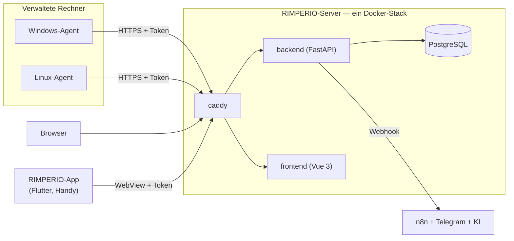

<div align="center">


# RIMPERIO

**Ein schlankes, selbst-gehostetes Remote Monitoring &amp; Management —
Rechner sehen, überwachen, patchen und aus der Ferne steuern. Für Windows und
Linux, ohne Lizenz, ohne Cloud.**

Diese Repo ist die **Übersicht**: kein Code, sondern Landkarte, Erklärung und
Einstieg in alle Teile des Projekts.

[](https://github.com/Phydran6/RIMPERIO-Server)
[](https://github.com/Phydran6/RIMPERIO-App)
[](LICENSE)

</div>

---

## Wo will ich hin?

| Ich will … | Hier entlang |
|---|---|
| **sofort loslegen** | [Schnellstart](#schnellstart) · [Server-Installation](https://github.com/Phydran6/RIMPERIO-Server#schnellstart) |
| **verstehen, wie das Ganze zusammenhängt** | [Architektur](docs/architektur.md) |
| **wissen, welches Repo wofür da ist** | [Komponenten](docs/komponenten.md) |
| **direkt zu einer Datei springen** | [Wegweiser — alle Links](docs/wegweiser.md) |
| **einen Rechner anbinden (Agent)** | [Server · Installer &amp; Signatur](https://github.com/Phydran6/RIMPERIO-Server/blob/main/installer/README.md) |
| **das System vom Handy steuern** | [RIMPERIO-App](https://github.com/Phydran6/RIMPERIO-App) |

---

## Was RIMPERIO ist

In der Tradition von [Tactical RMM](https://docs.tacticalrmm.com/), im Stil von
[LogBot](https://github.com/Phydran6/Logbot): ein Docker-Stack, ein
Installationsbefehl, eine Oberfläche im Browser — dazu ein Agent für Windows und
Linux und eine App fürs Handy.

| | |
|---|---|
| **Rechner sehen** | Inventur je Agent: OS, Hardware, Platten, Netz, installierte Software |
| **Überwachen** | Live-Werte (CPU/RAM/Platte), geplante Checks (Dienst, Port, Ping, Skript) |
| **Alarmieren** | Schwellen und „offline" — Alarme lösen sich selbst wieder auf |
| **Patchen** | Windows-Updates und Linux-Pakete suchen und einspielen |
| **Fernsteuern** | Befehle und Skripte an Agents schicken: PowerShell, CMD, Bash, sh |
| **Automatisieren** | Ausgehende Webhooks → n8n; Human-in-the-loop via Telegram + KI |
| **Ausliefern** | Agent als signierte `.exe` und `.msi` |

---

## Die Bausteine



| Repo | Was drin ist | Technik | Einstieg |
|---|---|---|---|
| 🖥️ **[RIMPERIO-Server](https://github.com/Phydran6/RIMPERIO-Server)** | Der Kern: Backend, Oberfläche, Agent, Installer, Deployment | Docker, FastAPI, Vue 3, PostgreSQL, Caddy, Go | [README](https://github.com/Phydran6/RIMPERIO-Server#readme) |
| 📱 **[RIMPERIO-App](https://github.com/Phydran6/RIMPERIO-App)** | Die eigene Instanz am Handy — gehärtete WebView, Token verschlüsselt | Flutter / Dart | [README](https://github.com/Phydran6/RIMPERIO-App#readme) |
| 🧭 **[RIMPERIO](https://github.com/Phydran6/RIMPERIO)** *(hier)* | Übersicht, Architektur, Wegweiser — kein Code | Markdown | [Wegweiser](docs/wegweiser.md) |

→ Ausführlich je Baustein: **[docs/komponenten.md](docs/komponenten.md)**

---

## Schnellstart

**Server** — auf einem Linux-Host mit Root:

```bash
curl -sSL https://raw.githubusercontent.com/Phydran6/RIMPERIO-Server/main/install.sh | sudo bash
```

Danach: Oberfläche unter `http://SERVER-IP/` (Anmeldung `admin` / `admin`, sofort
ändern). Agent anbinden über *Agents → Agent hinzufügen*.

**Handy** — [RIMPERIO-App](https://github.com/Phydran6/RIMPERIO-App) bauen bzw.
installieren, Server-Adresse eintragen, anmelden.

---

## Projektstand

| | |
|---|---|
| **Versionsschema** | `JAHR.MONAT.TAG.STUNDE.MINUTE.SEKUNDE` — in allen Repos gleich |
| **Lizenz** | [MIT](LICENSE) — wie alle Teile des Projekts |
| **Diese Repo** | trägt keine Releases und keine Tags — sie zeigt nur auf die anderen |

> **Ehrlich zur „von jedem Antivirus als OK"-Frage:** garantieren kann das
> niemand. Der seriöse Weg ist echtes Code Signing (kostenlos über SignPath
> Foundation für Open Source) + sauberer Build + Fehlalarm-Meldung — und genau
> den geht RIMPERIO. Einzelheiten:
> [Server · Installer &amp; Signatur](https://github.com/Phydran6/RIMPERIO-Server/blob/main/installer/README.md).

<div align="center">
<sub>Entwickelt von <a href="https://github.com/Phydran6">Phydran6</a></sub>
</div>
