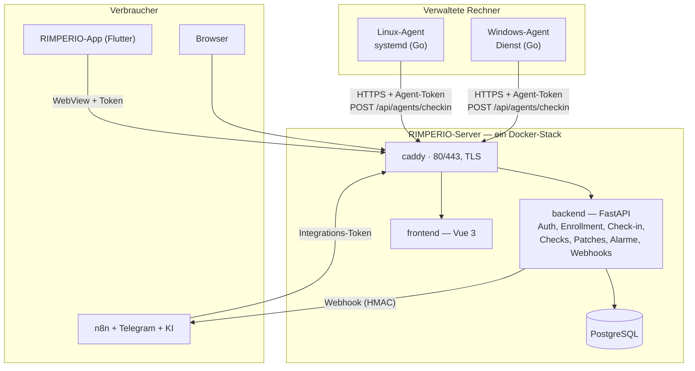

# Architektur

Wie die Teile zusammenspielen — vom Dienst auf dem verwalteten Rechner bis zur
Kachel im Browser und zur App am Handy.

← [Übersicht](../README.md) · [Komponenten](komponenten.md) · [Wegweiser](wegweiser.md)

---

## Das Gesamtbild

---

## Datenwege

- **Agent → Server** (nur ausgehend): Enrollment mit gemeinsamem Geheimnis, danach
  Check-in mit Messwerten, Inventur, Check-Ergebnisse und Befehls-Ergebnisse — alles
  über HTTPS mit `Authorization: Bearer <AGENT-TOKEN>`. Der Server verbindet sich
  **nie** zum Agent; der Agent holt seine Aufgaben beim Check-in ab (Pull).
- **Browser / App → Server**: REST unter `/api/*`, Sitzungs-Token (JWT). Die App ist
  eine gehärtete WebView auf dieselbe Oberfläche.
- **Server → n8n**: ausgehende, HMAC-signierte Webhooks bei Ereignissen
  (`alert.raised`, `command.finished`, `patch.available` …).
- **n8n/KI → Server**: zurück über ein langlebiges **Integrations-Token** —
  so lassen sich aus einem Telegram-Chat heraus Skripte auslösen (Human-in-the-loop).

---

## Drei Sorten Zugang

| Zugang | Wer | Wofür |
|---|---|---|
| **Sitzungs-Token** (JWT) | Benutzer, App | die ganze API, nach Rolle (admin/operator/readonly) |
| **Agent-Token** | Agents | nur Check-in, Inventur, Ergebnisse |
| **Integrations-Token** | n8n, KI | API im Namen einer Rolle, langlebig |

Dazu das **Enrollment-Geheimnis** als Vertrauensanker für die Erst-Anmeldung neuer
Agents — jederzeit im Browser wechselbar.

→ Einzelheiten und Sequenzdiagramme:
[RIMPERIO-Server/docs/architektur.md](https://github.com/Phydran6/RIMPERIO-Server/blob/main/docs/architektur.md)

---

## Weiter

- [Komponenten](komponenten.md)
- [Wegweiser — alle Links](wegweiser.md)
